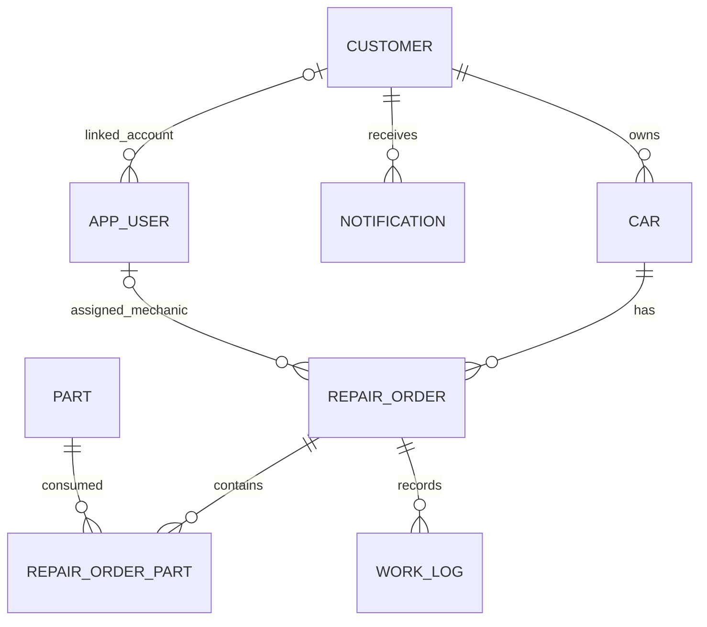

# AutoService Management System

ASP.NET Core 10 Web API for a small car repair workshop, with SQL Server, EF Core, JWT role authorization, repair orders, labor logs, spare parts, invoices, customer notifications and a separate Worker Service.

## Projects

| Project | Responsibility |
| --- | --- |
| `AutoService` | HTTP API, JWT, Swagger UI, SignalR and API controllers |
| `AutoService.Core` | Entities, DTOs, interfaces and business services |
| `AutoService.Infrastructure` | EF Core SQL Server, migrations and repositories |
| `AutoService.Worker` | Background notifications over HTTP (no direct database access) |
| `AutoService.Tests` | xUnit/Moq business-rule tests |

The MVC web frontend is a separate planned component. Swagger UI is the API test interface, **not** the customer website.

## Requirements

- .NET SDK 10
- SQL Server LocalDB on Windows, or change the `DefaultConnection` connection string to your own SQL Server
- Visual Studio 2022/2026 or a compatible editor

## First local run

1. Clone the repository and open `AutoServiceManagement.slnx`.
2. Set **development-only secrets** for the API. In PowerShell from the repository root:

   ```powershell
   $jwt = [Convert]::ToBase64String([System.Security.Cryptography.RandomNumberGenerator]::GetBytes(48))
   dotnet user-secrets set "Jwt:Key" "$jwt" --project AutoService/AutoService.csproj
   dotnet user-secrets set "BootstrapAdmin:Email" "admin@example.test" --project AutoService/AutoService.csproj
   dotnet user-secrets set "BootstrapAdmin:Password" "REPLACE_WITH_A_LONG_UNIQUE_PASSWORD" --project AutoService/AutoService.csproj
   ```

   Replace example credentials with your own. The API intentionally refuses to start without a signing key of at least 32 UTF-8 bytes. Never commit passwords or signing keys.

3. Restore/build and run:

   ```powershell
   dotnet restore AutoServiceManagement.slnx
   dotnet build AutoServiceManagement.slnx
   dotnet run --project AutoService/AutoService.csproj
   ```

   The API applies EF Core migrations on startup and creates the first admin **only when** `BootstrapAdmin` credentials are configured and no admin exists yet.

4. Open Swagger UI at `https://localhost:7146/swagger` when using the HTTPS launch profile (or the HTTPS address printed by `dotnet run`). Call `POST /api/auth/login`, copy the JWT, and use **Authorize** to test protected endpoints.

## Worker setup

Using the admin JWT, call `POST /api/auth/staff` to create a user with role `Service`. Then configure the Worker secrets:

```powershell
dotnet user-secrets set "Worker:Email" "worker@example.test" --project AutoService.Worker/AutoService.Worker.csproj
dotnet user-secrets set "Worker:Password" "REPLACE_WITH_WORKER_PASSWORD" --project AutoService.Worker/AutoService.Worker.csproj
dotnet user-secrets set "Api:BaseUrl" "https://localhost:7146" --project AutoService.Worker/AutoService.Worker.csproj
dotnet run --project AutoService.Worker/AutoService.Worker.csproj
```

The Worker logs in as `Service`, checks completed repair orders every 15 minutes, and checks due maintenance once a day. Notifications are stored in the database with unique keys so retries do not create duplicates. Customers read messages at `GET /api/me/notifications`. The Worker rejects non-local HTTP endpoints; use HTTPS for any remote API.

## Permissions

| Role | Access |
| --- | --- |
| Admin | Manage customers, vehicles, parts, orders, and mechanic assignments; create staff accounts |
| Mechanic | View assigned repair orders, change assigned repair status, record labor and consume parts |
| Customer | Register and sign in; read **only their own** cars, repairs, invoices and notifications through `/api/me` |
| Service | Background notification and maintenance endpoints only |

Mechanics are assigned with `PUT /api/repair-orders/{id}/assign`. Each work log gets the mechanic user ID from the authenticated JWT, not from an editable request parameter.

## Important API routes

| Method | Path |
| --- | --- |
| POST | `/api/auth/register` |
| POST | `/api/auth/login` |
| POST | `/api/auth/staff` |
| GET/POST | `/api/customers`, `/api/cars`, `/api/parts`, `/api/repair-orders` |
| GET | `/api/cars/{id}/history` |
| PUT | `/api/repair-orders/{id}/assign` |
| PATCH | `/api/repair-orders/{id}/status` |
| POST/GET | `/api/repair-orders/{id}/parts` |
| POST/GET | `/api/repair-orders/{id}/worklogs` |
| GET | `/api/repair-orders/{id}/invoice` |
| GET | `/api/me/cars`, `/api/me/repair-orders`, `/api/me/notifications` |
| GET | `/api/me/repair-orders/{id}/invoice` |
| GET | `/api/cars/service-due?days=14` |
| GET/POST | `/api/notifications/...` |
| WebSocket | `/ws/orders` — authenticated SignalR notifications |

The GET list endpoints accept `search`, `sort`, `page`, `pageSize`. Repair invoices use stored part-price and hourly-rate snapshots and the configurable VAT rate in `Invoice:VatRate` (default `0.24`).

The `AutoService/AutoService.http` file contains example HTTP requests for testing.

## Entity relationships



## Tests and CI

Run:

```powershell
dotnet test AutoServiceManagement.slnx
```

Tests cover VAT calculations and validation of mechanic work logs, including mocked repositories. GitHub Actions builds and tests on every push to `main`.

## Security and deployment notes

- Keep `Jwt:Key`, account passwords and Worker credentials out of source control.
- Configure `Cors:AllowedOrigins` with the actual MVC frontend origin when that client is added; the default empty list does not grant cross-origin access.
- The default SQL Server connection string targets **Windows LocalDB**; change it for another environment.
- Role and ownership checks in the API do not replace production security testing, rate limits, TLS, real email verification, or reliable outbound messaging.
- Current Worker notifications are stored in the application database for the customer portal; the system does **not** send emails or SMS.
- Never assume a passing build alone verifies database migrations, LocalDB availability or end-to-end authenticated flows.
